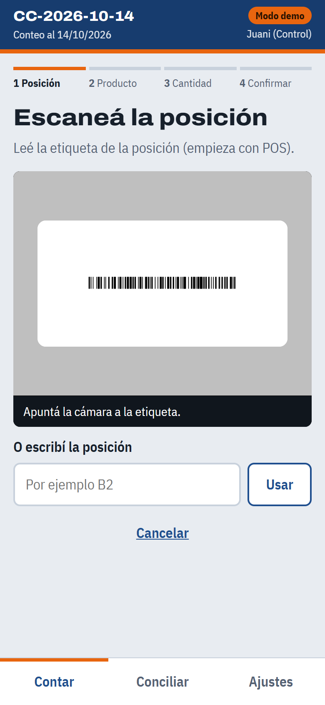
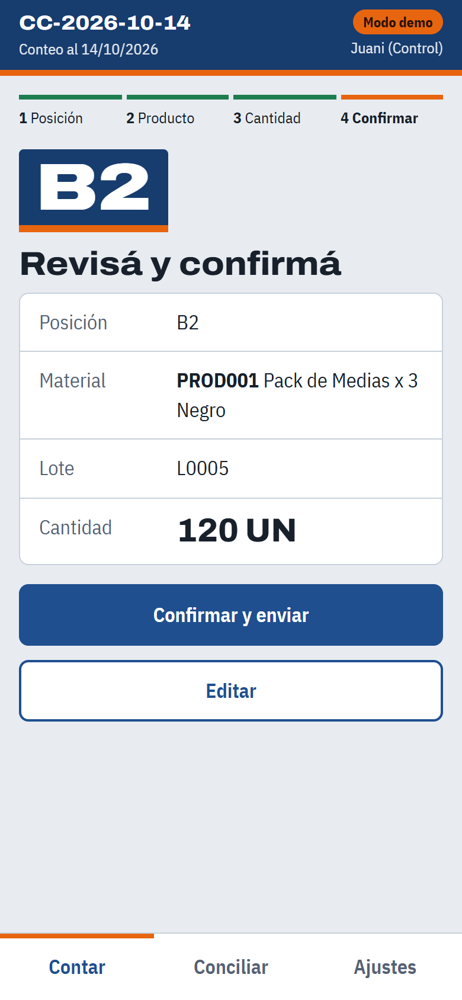
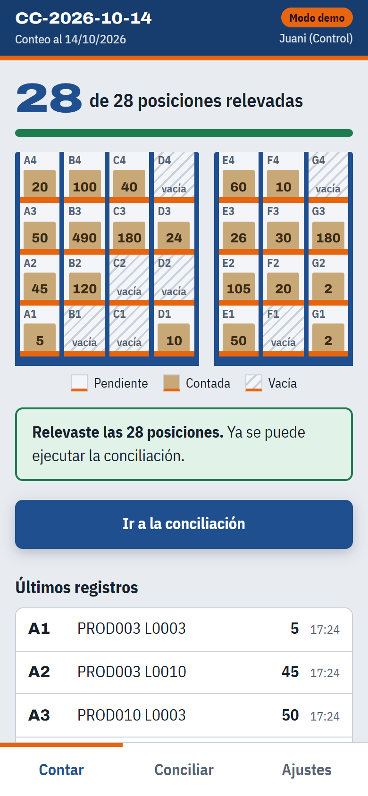
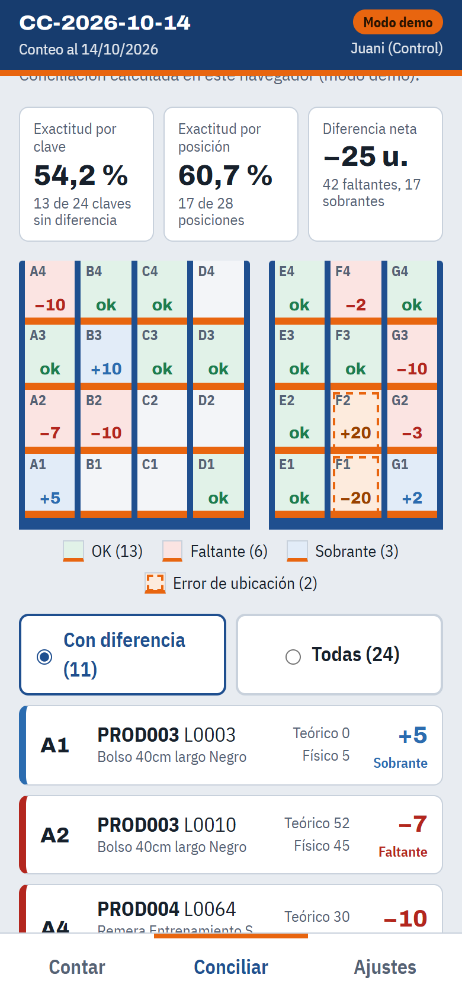

# Conteo cíclico y conciliación de inventarios · TP6

[](https://github.com/juaniguardiolaa/ConteoCiclico_PCP/actions/workflows/tests.yml)

Planificación y Control de la Producción · UTN FRH · 2026

App web para el celular que simula el conteo cíclico del 14/10/2026 de un almacén de 28 posiciones (A1 a G4) y 10 materiales. Lee el QR o el código de barras de cada posición y de cada producto-lote, valida los datos, los envía a Google Sheets y ejecuta la conciliación contra el stock del 30/09/2026 y los movimientos del 01 al 14/10/2026.

| | |
| --- | --- |
| **App** | https://juaniguardiolaa.github.io/ConteoCiclico_PCP/ |
| **Etiquetas para imprimir** | https://juaniguardiolaa.github.io/ConteoCiclico_PCP/etiquetas.html |
| **Diagrama de flujo** | https://juaniguardiolaa.github.io/ConteoCiclico_PCP/diagrama/ ([Hoja 1](docs/diagrama/hoja1.png), [Hoja 2](docs/diagrama/hoja2.png)) |
| **Planilla de Google Sheets** | Se comparte por mail con la cátedra. El enlace no se publica porque la hoja Parametros tiene el token del Web App. |
| **Guion de la simulación** | [SIMULACION.md](SIMULACION.md) |
| **Instalar la planilla** | [apps-script/INSTALAR.md](apps-script/INSTALAR.md) |
| **Plan de desarrollo** | [PLAN.md](PLAN.md) |

<table>
  <tr>
    <td></td>
    <td></td>
    <td></td>
    <td></td>
  </tr>
</table>

## Qué pide la consigna y cómo se resuelve

| La app tiene que… | Cómo lo hace |
| --- | --- |
| Leer QR o código de barras | Cámara del celular con html5-qrcode (QR y Code 128). Cada etiqueta trae los dos códigos y el texto para cargarlo a mano. |
| Registrar posición, material, lote y cantidad | Etiqueta de posición `POS:B2`, etiqueta de producto-lote `MAT:PROD001\|L0005` y cantidad con teclado numérico, en cuatro pasos con confirmación. |
| Transferir automáticamente a Google Sheets | Cada registro confirmado se envía al Web App de Apps Script, que lo vuelve a validar y lo agrega a la hoja Conteo_1410 con ID, fecha-hora, usuario y dispositivo. Sin conexión queda en una cola y se envía solo. |
| Ejecutar la conciliación | Desde la app (Control o Jefe de almacén) o desde el menú **Inventario** de la planilla. La hoja Conciliacion se arma con fórmulas SUMIFS y la hoja Resumen con los indicadores. |

## Cómo se usa

Cada persona entra con su nombre y su rol, que son los carriles del diagrama de flujo:

- **Operario de conteo:** recorre el rack y cuenta. Ve el mapa de posiciones pendientes y las que ya contó, pero nunca el stock teórico (conteo ciego).
- **Control de inventarios:** además de contar, ejecuta la conciliación, pide reconteos y analiza las diferencias en la planilla.
- **Jefe de almacén:** aprueba los ajustes y el cierre del conteo.

### Contar una posición

1. **Escanear posición.** Se lee la etiqueta de la posición. La app rechaza una posición que no existe (`POS:Z9`) o que ya se contó en la campaña (duplicado).
2. **Escanear producto.** Se lee la etiqueta del producto-lote. Rechaza un material inexistente o un lote mal formado; si el lote no figura en el sistema, advierte y deja registrarlo igual (después aparece como NO_REGISTRADO). Si la posición está vacía, se toca **La posición está vacía**.
3. **Cantidad.** Entero entre 0 y 9999; negativos o decimales no pasan.
4. **Confirmar y enviar.** El registro se guarda con un ID único y se envía. Si se repite el envío, no se duplica.

### Conciliación, análisis y cierre

En la pestaña **Conciliar**, la app avisa si faltan posiciones por contar y ejecuta la conciliación en la planilla. Muestra la exactitud, la diferencia neta, el rack coloreado por resultado y el cálculo de cada clave. Además confirma que la hoja de la planilla dé lo mismo que el cálculo de la app.

El análisis de cada diferencia (causa, acción y aprobación), el registro de ajustes y transferencias, la foto de la conciliación y el cierre se hacen desde el menú **Inventario** de la planilla. El paso a paso está en [INSTALAR.md](apps-script/INSTALAR.md#análisis-de-diferencias-y-cierre-hoja-2-del-diagrama). Un reconteo se puede pedir desde la app: le aparece al operario en la ruta y el nuevo conteo reemplaza al anterior.

### Sin conexión

Con el celular en modo avión, lo que se confirma queda guardado en el celular y el mapa lo marca con un punto naranja. Se envía solo cuando vuelve la red. La app se puede abrir y recargar sin conexión después de la primera visita. Para mostrarlo sin cortar la red: **Ajustes → Simular que no hay conexión** (solo en modo demo).

### Modo demo

Sin planilla configurada, la app funciona igual con los datos guardados en el navegador. Sirve para probarla y para que cualquiera del grupo la explore:

- **Ajustes → Cargar el conteo del enunciado** completa las 28 posiciones con el stock físico del 14/10 y deja lista la conciliación.
- Controles para probar: `Z9` (posición inexistente), `B2` dos veces (duplicado), `PROD001 L005` (lote mal formado), `PROD001 L0099` (lote desconocido, solo advierte), cantidad `-12` o `1,5`.
- La hoja de etiquetas, con la opción **Etiquetas de prueba de los controles**, trae esos casos impresos.

## Resultado con los datos del caso

| Indicador | Valor |
| --- | --- |
| Claves conciliadas (código, lote, posición) | 24 |
| Claves sin diferencia | 13 |
| Exactitud por clave | 54,2 % |
| Posiciones sin diferencia | 17 de 28 (60,7 %) |
| Teórico / físico total | 1.594 / 1.569 unidades |
| Diferencia neta | −25 unidades: 42 faltantes y 17 sobrantes, más un error de ubicación que suma cero (F1 → F2) |

La tabla completa por clave está en [PLAN.md](PLAN.md#resultado-esperado). La verifican los tests en cada push, tanto el cálculo de la app como las fórmulas de la planilla.

## Reglas de la conciliación

- **Clave:** código + lote + posición. Las filas del stock al 30/09 sin lote ni posición y en cero (PROD006, PROD007, PROD009) solo dicen que el material existe: no generan clave.
- **Teórico al 14/10** = stock al 30/09 + movimientos con fecha del 01/10 al 14/10 (las cantidades ya traen signo). Se abre en ingresos, salidas y ajustes.
- **Físico al 14/10** = suma de los registros de conteo VALIDO de la campaña. Un reconteo deja el registro anterior como REEMPLAZADO.
- **Diferencia** = físico − teórico.
- **Clasificación**, en este orden: OK (dentro de la tolerancia), NO_REGISTRADO (material-lote que el sistema no conoce), UBICACION (el mismo material-lote suma cero entre posiciones), FALTANTE o SOBRANTE.
- **Tolerancia:** 0 para todos los materiales. El caso no trae costos para calcular la clase ABC, así que todos se tratan como clase A. Es un parámetro editable en Maestro_Materiales.
- **Exactitud:** se informan dos definiciones, por clave (claves OK / claves) y por posición (posiciones sin diferencia / 28).

## Para el grupo: trabajar con el repo

Hace falta [Node.js](https://nodejs.org/) 20 o superior. No hay que instalar dependencias para usar la app ni para los tests.

```bash
git clone https://github.com/juaniguardiolaa/ConteoCiclico_PCP.git
```

```bash
npm run dev
```

```bash
npm test
```

`npm run dev` abre la app en http://localhost:8080 (en localhost la cámara funciona). Cada push a `main` corre los tests y publica la app en GitHub Pages en uno o dos minutos. Para probar cambios sin tocar la versión publicada: trabajar en una rama y abrir un pull request.

| Carpeta | Qué hay |
| --- | --- |
| `docs/` | La app (HTML, CSS y JavaScript sin build). Es lo que publica GitHub Pages. |
| `docs/js/dominio/` | Lógica pura con tests: etiquetas, validaciones, registros, cola, conciliación, indicadores, ajustes. |
| `docs/js/pantallas/` | Una pantalla por paso del diagrama de flujo. |
| `apps-script/` | Servidor: `Code.gs` (se edita a mano), `Datos.gs` y `Dominio.gs` (generados) y `conteo-ciclico.gs`, el archivo único que se pega en Apps Script. |
| `data/` | Excel del caso entregado por la cátedra, sin modificar. |
| `scripts/` | Exportación de datos del Excel, generación del código de Apps Script y servidor local. |
| `tests/` | 85 tests con `node --test`, incluido un simulador de Google Sheets que calcula las fórmulas de la planilla. |
| `evidencias/` | Capturas de la app. |

Comandos de mantenimiento:

- Si cambia algo de `docs/js/dominio/` o de `apps-script/Code.gs`: `npm run apps-script` vuelve a armar `apps-script/conteo-ciclico.gs`. Después hay que pegarlo en la planilla y publicar una versión nueva ([INSTALAR.md](apps-script/INSTALAR.md#cuando-cambia-el-código)). Los tests avisan si alguien se olvida de regenerarlo.
- Si cambia el Excel de `data/`: `npm install` y `npm run datos`. Es el único caso en que hace falta instalar algo.
- [CLAUDE.md](CLAUDE.md) resume las reglas del proyecto para trabajar con Claude Code.

## Decisiones y supuestos

- **Fechas:** la campaña se llama `CC-2026-10-14` y concilia al 14/10/2026, aunque la simulación se haga otro día. Cada registro guarda además la fecha-hora real del celular y la hora en que llegó a la planilla.
- **Posiciones vacías:** se registran con cantidad 0, para dejar constancia de que se recorrieron las 28 posiciones.
- **Tipo de movimiento nuevo:** `Transferencia_Posicion`, para corregir el error de ubicación F1 → F2 sin ajustar cantidades. El caso no trae un tipo para mover un lote de posición.
- **Seguridad:** el Web App pide un token que está en la hoja Parametros y se carga en cada celular. No está en el repo.
- **Configuración regional de la planilla:** Inglés (Estados Unidos). Con «Argentina», las fórmulas que escribe el script quedan en `#ERROR!` porque esperan «;» entre argumentos. Las fechas igual se ven como dd/mm/aaaa.

## Equipo

| Integrante | Rol en la simulación | Responsabilidad en el TP |
| --- | --- | --- |
| (completar) | Jefe de almacén | |
| (completar) | Control de inventarios | |
| (completar) | Operario de conteo 1 (bloque A–D) | |
| (completar) | Operario de conteo 2 (bloque E–G) | |
| (completar) | Registro de evidencias | |

Desarrollado con Claude Code a partir del plan y el diagrama de flujo del grupo.
